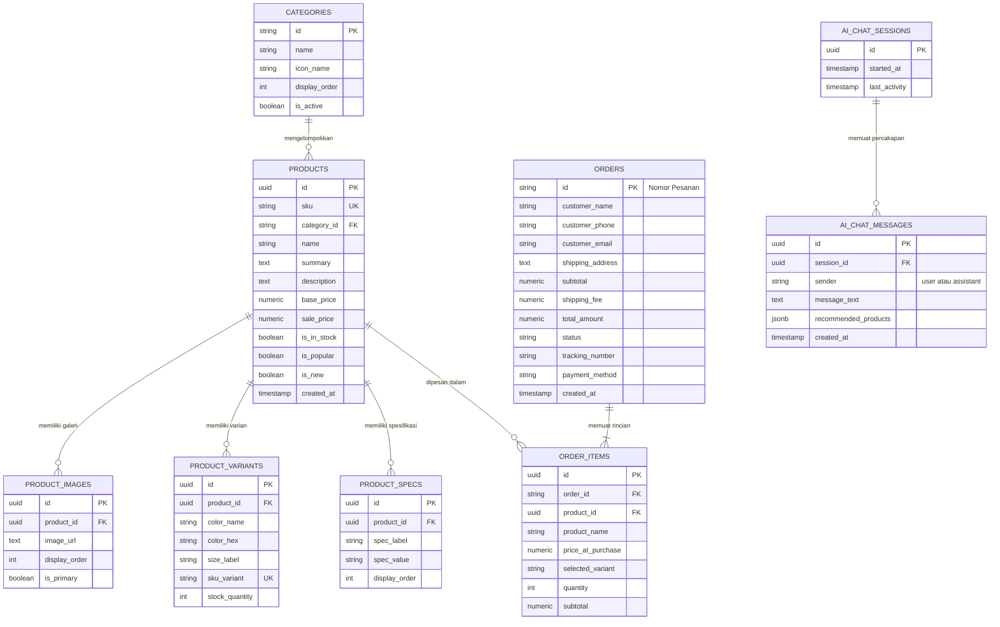

# Dokumentasi Perancangan Basis Data: Torin Store

Dokumentasi ini memuat spesifikasi skema basis data untuk **Torin Store**. Sistem dirancang dengan pendekatan *Guest Checkout / Direct Order* yang efisien tanpa memerlukan sistem autentikasi akun pengguna (`users`) maupun sistem ulasan/wishlist terpisah.

---

## 1. Arsitektur & Prinsip Desain

* **Engine Rekomendasi**: PostgreSQL 15+ (mendukung tipe data JSONB, UUID, dan Full-Text Search).
* **Model Transaksi**: *Direct Checkout / Guest Order* — seluruh informasi pengiriman dan kontak pembeli tersimpan langsung (*embedded*) pada record pesanan.
* **Integritas Finansial**: Tabel `order_items` mengunci salinan nama barang, harga beli riil, dan varian pada saat transaksi terjadi (*historical snapshot*).

---

## 2. Diagram Hubungan Entitas (ERD)



---

## 3. Rincian Skema & Kamus Data

### 3.1. Tabel `categories`
Menyimpan kelompok kategori barang untuk bar navigasi dan filter.

| Kolom | Tipe Data | Keterangan |
| :--- | :--- | :--- |
| `id` | `VARCHAR(50)` | Primary Key (contoh: `elektronik`, `fashion-pria`, `sepatu`) |
| `name` | `VARCHAR(100)` | Label kategori tampil (contoh: `Elektronik & Audio`) |
| `icon_name` | `VARCHAR(50)` | Identifier icon Lucide (contoh: `Laptop`, `Shirt`, `Watch`) |
| `display_order`| `INT DEFAULT 0` | Urutan penataan pada bar navigasi |
| `is_active` | `BOOLEAN DEFAULT TRUE` | Status aktif/tampil |

---

### 3.2. Tabel `products`
Menyimpan data master katalog produk.

| Kolom | Tipe Data | Keterangan |
| :--- | :--- | :--- |
| `id` | `UUID` | Primary Key (`gen_random_uuid()`) |
| `sku` | `VARCHAR(50)` | Kode stok unik resmi (contoh: `TRN-AUD-001`) |
| `category_id` | `VARCHAR(50)` | Foreign Key merujuk ke `categories(id)` |
| `name` | `VARCHAR(255)` | Nama lengkap barang |
| `summary` | `VARCHAR(500)` | Deskripsi singkat (tampil pada kartu katalog) |
| `description` | `TEXT` | Deskripsi mendalam (tampil pada halaman detail) |
| `base_price` | `NUMERIC(12, 2)`| Harga acuan normal / coret |
| `sale_price` | `NUMERIC(12, 2)`| Harga jual aktif saat ini |
| `is_in_stock` | `BOOLEAN DEFAULT TRUE` | Penanda stok barang siap kirim |
| `is_popular` | `BOOLEAN DEFAULT FALSE`| Flag kurasi terpopuler (Best Seller) |
| `is_new` | `BOOLEAN DEFAULT FALSE`| Flag penanda rilis terbaru |
| `created_at` | `TIMESTAMP WITH TIME ZONE` | Waktu produk ditambahkan |
| `updated_at` | `TIMESTAMP WITH TIME ZONE` | Waktu terakhir diubah |

---

### 3.3. Tabel `product_images`
Menyimpan banyak foto untuk galeri per produk.

| Kolom | Tipe Data | Keterangan |
| :--- | :--- | :--- |
| `id` | `UUID` | Primary Key |
| `product_id` | `UUID` | Foreign Key ke `products(id)` ON DELETE CASCADE |
| `image_url` | `TEXT` | Tautan absolut file gambar (CDN / Object Storage) |
| `display_order`| `INT DEFAULT 0` | Urutan tampilan di thumbnail slider |
| `is_primary` | `BOOLEAN DEFAULT FALSE` | Foto utama untuk kartu katalog |

---

### 3.4. Tabel `product_variants`
Menyimpan kombinasi varian spesifik (warna, ukuran, dan stok fisik masing-masing).

| Kolom | Tipe Data | Keterangan |
| :--- | :--- | :--- |
| `id` | `UUID` | Primary Key |
| `product_id` | `UUID` | Foreign Key ke `products(id)` ON DELETE CASCADE |
| `color_name` | `VARCHAR(50)` | Nama warna (contoh: `Matte Charcoal`, `Ecru`) |
| `color_hex` | `VARCHAR(10)` | Kode warna hex untuk swatch (contoh: `#262626`) |
| `size_label` | `VARCHAR(20)` | Ukuran pakaian/sepatu (contoh: `M`, `L`, `42`) |
| `sku_variant` | `VARCHAR(70)` | SKU spesifik varian (`TRN-AUD-001-BLK`) |
| `stock_quantity`| `INT DEFAULT 0` | Jumlah unit fisik tersedia |

---

### 3.5. Tabel `product_specifications`
Menyimpan parameter teknis terstruktur (material, bobot, dimensi, daya baterai).

| Kolom | Tipe Data | Keterangan |
| :--- | :--- | :--- |
| `id` | `UUID` | Primary Key |
| `product_id` | `UUID` | Foreign Key ke `products(id)` ON DELETE CASCADE |
| `spec_label` | `VARCHAR(100)` | Label atribut (contoh: `Bahan`, `Bobot`, `Garansi`) |
| `spec_value` | `TEXT` | Isi spesifikasi (contoh: `100% Combed Cotton 420 GSM`) |
| `display_order`| `INT DEFAULT 0` | Urutan baris pada tabel spesifikasi |

---

### 3.6. Tabel `orders` (Guest Checkout)
Menyimpan transaksi pemesanan langsung tanpa akun pembeli.

| Kolom | Tipe Data | Keterangan |
| :--- | :--- | :--- |
| `id` | `VARCHAR(32)` | Primary Key (Format: `TRN-YYYYMMDD-XXXXX`) |
| `customer_name` | `VARCHAR(150)` | Nama lengkap penerima barang |
| `customer_phone`| `VARCHAR(30)` | Nomor telepon / WhatsApp aktif |
| `customer_email`| `VARCHAR(150)` | Alamat email untuk pengiriman tanda terima (invoice) |
| `shipping_address`| `TEXT` | Alamat lengkap tujuan pengiriman |
| `subtotal` | `NUMERIC(12, 2)`| Total harga barang sebelum ongkir |
| `shipping_fee` | `NUMERIC(12, 2)`| Biaya pengiriman |
| `total_amount` | `NUMERIC(12, 2)`| Total bersih yang harus dibayar |
| `status` | `VARCHAR(30)` | `pending`, `paid`, `processing`, `shipped`, `completed`, `cancelled` |
| `tracking_number`| `VARCHAR(100)` | Nomor resi ekspedisi (JNE / SiCepat / J&T) |
| `payment_method` | `VARCHAR(50)` | Metode (Transfer Bank, QRIS, Virtual Account) |
| `created_at` | `TIMESTAMP WITH TIME ZONE` | Waktu pemesanan dibuat |

---

### 3.7. Tabel `order_items`
Rincian setiap barang dalam transaksi pesanan (*historical record*).

| Kolom | Tipe Data | Keterangan |
| :--- | :--- | :--- |
| `id` | `UUID` | Primary Key |
| `order_id` | `VARCHAR(32)` | Foreign Key ke `orders(id)` ON DELETE CASCADE |
| `product_id` | `UUID` | Foreign Key ke `products(id)` ON DELETE SET NULL |
| `product_name` | `VARCHAR(255)` | Snapshot nama produk saat dibeli |
| `price_at_purchase`| `NUMERIC(12, 2)`| Snapshot harga riil saat transaksi |
| `selected_variant` | `VARCHAR(100)`| Catatan varian terpilih (contoh: `Matte Charcoal / 42`) |
| `quantity` | `INT DEFAULT 1` | Kuantitas dibeli |
| `subtotal` | `NUMERIC(12, 2)`| Hasil perkalian `price_at_purchase * quantity` |

---

### 3.8. Tabel `ai_chat_sessions` & `ai_chat_messages`
Menyimpan sesi interaksi asisten cerdas Torin AI Concierge.

| Tabel | Kolom | Tipe Data | Keterangan |
| :--- | :--- | :--- | :--- |
| `ai_chat_sessions` | `id` | `UUID` | Primary Key per sesi browser |
| | `started_at` | `TIMESTAMP` | Waktu sesi dibuka |
| | `last_activity` | `TIMESTAMP` | Waktu pembaruan pesan terakhir |
| `ai_chat_messages` | `id` | `UUID` | Primary Key per pesan |
| | `session_id` | `UUID` | Foreign Key ke `ai_chat_sessions(id)` |
| | `sender` | `VARCHAR(20)` | `user` atau `assistant` |
| | `message_text`| `TEXT` | Teks isi pertanyaan / jawaban |
| | `recommended_products` | `JSONB` | Array ID produk yang disarankan oleh AI |
| | `created_at` | `TIMESTAMP` | Waktu pesan dikirim |

---

## 4. Skrip DDL SQL (PostgreSQL Ready-to-Run)

```sql
-- Aktifkan ekstensi UUID
CREATE EXTENSION IF NOT EXISTS "uuid-ossp";

-- 1. TABEL KATEGORI
CREATE TABLE categories (
    id VARCHAR(50) PRIMARY KEY,
    name VARCHAR(100) NOT NULL,
    icon_name VARCHAR(50) NOT NULL DEFAULT 'LayoutGrid',
    display_order INT NOT NULL DEFAULT 0,
    is_active BOOLEAN NOT NULL DEFAULT TRUE
);

-- 2. TABEL PRODUK
CREATE TABLE products (
    id UUID PRIMARY KEY DEFAULT gen_random_uuid(),
    sku VARCHAR(50) NOT NULL UNIQUE,
    category_id VARCHAR(50) NOT NULL REFERENCES categories(id) ON UPDATE CASCADE,
    name VARCHAR(255) NOT NULL,
    summary VARCHAR(500),
    description TEXT,
    base_price NUMERIC(12, 2) NOT NULL,
    sale_price NUMERIC(12, 2) NOT NULL,
    is_in_stock BOOLEAN NOT NULL DEFAULT TRUE,
    is_popular BOOLEAN NOT NULL DEFAULT FALSE,
    is_new BOOLEAN NOT NULL DEFAULT FALSE,
    created_at TIMESTAMP WITH TIME ZONE DEFAULT CURRENT_TIMESTAMP,
    updated_at TIMESTAMP WITH TIME ZONE DEFAULT CURRENT_TIMESTAMP
);

-- 3. TABEL GAMBAR PRODUK
CREATE TABLE product_images (
    id UUID PRIMARY KEY DEFAULT gen_random_uuid(),
    product_id UUID NOT NULL REFERENCES products(id) ON DELETE CASCADE,
    image_url TEXT NOT NULL,
    display_order INT NOT NULL DEFAULT 0,
    is_primary BOOLEAN NOT NULL DEFAULT FALSE
);

-- 4. TABEL VARIAN PRODUK
CREATE TABLE product_variants (
    id UUID PRIMARY KEY DEFAULT gen_random_uuid(),
    product_id UUID NOT NULL REFERENCES products(id) ON DELETE CASCADE,
    color_name VARCHAR(50),
    color_hex VARCHAR(10),
    size_label VARCHAR(20),
    sku_variant VARCHAR(70) UNIQUE,
    stock_quantity INT NOT NULL DEFAULT 0
);

-- 5. TABEL SPESIFIKASI PRODUK
CREATE TABLE product_specifications (
    id UUID PRIMARY KEY DEFAULT gen_random_uuid(),
    product_id UUID NOT NULL REFERENCES products(id) ON DELETE CASCADE,
    spec_label VARCHAR(100) NOT NULL,
    spec_value TEXT NOT NULL,
    display_order INT NOT NULL DEFAULT 0
);

-- 6. TABEL PESANAN (GUEST CHECKOUT)
CREATE TABLE orders (
    id VARCHAR(32) PRIMARY KEY,
    customer_name VARCHAR(150) NOT NULL,
    customer_phone VARCHAR(30) NOT NULL,
    customer_email VARCHAR(150),
    shipping_address TEXT NOT NULL,
    subtotal NUMERIC(12, 2) NOT NULL,
    shipping_fee NUMERIC(12, 2) NOT NULL DEFAULT 0.00,
    total_amount NUMERIC(12, 2) NOT NULL,
    status VARCHAR(30) NOT NULL DEFAULT 'pending',
    tracking_number VARCHAR(100),
    payment_method VARCHAR(50),
    created_at TIMESTAMP WITH TIME ZONE DEFAULT CURRENT_TIMESTAMP
);

-- 7. TABEL ITEM RINCIAN PESANAN
CREATE TABLE order_items (
    id UUID PRIMARY KEY DEFAULT gen_random_uuid(),
    order_id VARCHAR(32) NOT NULL REFERENCES orders(id) ON DELETE CASCADE,
    product_id UUID REFERENCES products(id) ON DELETE SET NULL,
    product_name VARCHAR(255) NOT NULL,
    price_at_purchase NUMERIC(12, 2) NOT NULL,
    selected_variant VARCHAR(100),
    quantity INT NOT NULL DEFAULT 1,
    subtotal NUMERIC(12, 2) NOT NULL
);

-- 8. TABEL RIWAYAT CHAT AI
CREATE TABLE ai_chat_sessions (
    id UUID PRIMARY KEY DEFAULT gen_random_uuid(),
    started_at TIMESTAMP WITH TIME ZONE DEFAULT CURRENT_TIMESTAMP,
    last_activity TIMESTAMP WITH TIME ZONE DEFAULT CURRENT_TIMESTAMP
);

CREATE TABLE ai_chat_messages (
    id UUID PRIMARY KEY DEFAULT gen_random_uuid(),
    session_id UUID NOT NULL REFERENCES ai_chat_sessions(id) ON DELETE CASCADE,
    sender VARCHAR(20) NOT NULL CHECK (sender IN ('user', 'assistant')),
    message_text TEXT NOT NULL,
    recommended_products JSONB,
    created_at TIMESTAMP WITH TIME ZONE DEFAULT CURRENT_TIMESTAMP
);

-- INDEKS PERFORMA
CREATE INDEX idx_products_category ON products(category_id);
CREATE INDEX idx_products_sale_price ON products(sale_price);
CREATE INDEX idx_products_filter ON products(category_id, sale_price, is_in_stock);
CREATE INDEX idx_order_items_order ON order_items(order_id);
CREATE INDEX idx_chat_messages_session ON ai_chat_messages(session_id);
```

---

## 5. Ringkasan Keunggulan Skema Ini

1. **Ramping & Ringan**: Tanpa dependensi login/user management, pengguna dapat langsung bertransaksi dengan alur gesit (*zero friction checkout*).
2. **Histori Pesanan Terlindungi**: Perubahan harga master di masa depan tidak akan merusak kalkulasi buku kas pada pesanan lama karena telah dilindungi kolom snapshot pada `order_items`.
3. **Penyimpanan AI Terisolasi**: Log percakapan AI disimpan secara terpisah dalam sesi anonim, memudahkan pembersihan otomatis (*cron job garbage collection*) tanpa membebani tabel katalog utama.
